# Enterprise Cloud DevOps & Kubernetes Platform

An interview-ready personal portfolio project connecting secure application delivery, local Kubernetes operations, Linux automation, and an AWS network infrastructure blueprint. It demonstrates personal hands-on learning at Junior+ level; it is not presented as a production system or work performed for an employer.



## Architecture Description

The architecture deliberately separates **design-time cloud infrastructure** from the **runnable local platform**:

1. A developer pushes source code, Terraform, Ansible, Helm, Kubernetes manifests, and documentation to GitHub.
2. Pull-request CI runs application tests, builds and scans the container image, validates Terraform, renders and validates Helm manifests, checks Ansible syntax, and verifies documentation. It never deploys infrastructure.
3. After an approved merge to `main`, GitHub Actions publishes the image to GHCR with the immutable Git commit SHA. Publishing does not trigger a Kubernetes or AWS deployment.
4. For the real hands-on runtime, the operator manually loads a local image—or pulls an authorized GHCR image—into the Kind cluster and installs the Helm release.
5. Local traffic follows `127.0.0.1:18080 → Kind NodePort 30080 → Kubernetes Service → two FastAPI Pods on port 8080`. Readiness controls Service endpoints, while startup and liveness probes supervise container health.
6. Ansible optionally prepares a separate disposable Ubuntu VM with Docker, kubectl, Kind, and Helm. It does not configure the user's Windows host or Docker Desktop directly.
7. Terraform defines an independent AWS VPC blueprint with two availability zones and isolated public/private routing. The AWS VPC is not connected to the local Kind cluster, and CI never runs `terraform apply`.

Editable Mermaid sources and the CI/Kubernetes diagrams are documented in [the architecture overview](docs/architecture/architecture-overview.md).

## What This Project Demonstrates

| Capability | Actual use in this repository |
|---|---|
| Python / FastAPI | Fictional infrastructure inventory API with health, readiness and version endpoints |
| Docker | Multi-stage, non-root image with a built-in health check |
| Kubernetes | Two replicas on local Kind, probes, limits, ConfigMap, ServiceAccount and rolling updates |
| Helm | Parameterized install, upgrade, scale and rollback lifecycle |
| GitHub Actions | PR validation and SHA-tagged GHCR publishing after merge to `main` |
| Terraform / AWS | Validation-only VPC blueprint in `eu-central-1`; never applied automatically |
| Ansible / Linux | Optional, idempotent setup of a disposable Ubuntu lab VM |
| Security | Least privilege, no embedded secrets, Trivy, Checkov and restricted containers |
| Operations | Ten isolated Kubernetes incident labs and bounded troubleshooting commands |

## Honest Environment Boundary

- **Environment A — AWS blueprint:** Terraform models a VPC (`10.30.0.0/16`), two AZs, public/private subnets, route tables, IGW and a restricted application security group. No AWS resources are deployed by CI.
- **Environment B — local runtime:** Docker Desktop and Kind run the application locally. Helm manages the release. This cluster is **not** inside the AWS VPC.

## Repository Map

```text
app/                  FastAPI source
tests/                pytest API tests
terraform/            AWS blueprint and network module
ansible/              optional Ubuntu VM configuration
kubernetes/           Kind config, namespace and 10 incident labs
helm/                 reusable application chart
scripts/              health, troubleshooting and lab helpers
docs/                  education, operations, security and diagrams
.github/workflows/     read-only PR CI and main-branch image publishing
```

## Quick Start (WSL2 Ubuntu)

Prerequisites: Python 3.12, Docker Desktop with WSL integration, `kubectl`, Kind, Helm, GNU Make.

```bash
git clone https://github.com/AhmedZaki2206/Project-6-enterprise-cloud-devops-kubernetes-platform.git
cd Project-6-enterprise-cloud-devops-kubernetes-platform
make setup
make test
make kind-up
make deploy
make health
curl http://127.0.0.1:18080/api/servers
```

`make deploy` builds `infrastructure-operations-api:local`, loads it into the named Kind cluster, creates only the project namespace, and installs the Helm release. It does not contact AWS.

## API

| Endpoint | Purpose |
|---|---|
| `GET /` | Service identity and runtime environment |
| `GET /health/live` | Process liveness |
| `GET /health/ready` | Traffic readiness |
| `GET /version` | Build-supplied application version |
| `GET /api/servers` | Clearly fictional server list |
| `GET /api/servers/{id}` | Validated lookup and meaningful 404 response |

## CI/CD Lifecycle

Pull requests run `ruff`, `pytest`, Docker build, Trivy, Terraform format/init/validate, Checkov, Helm lint/template, manifest validation, Ansible syntax, and documentation checks. CI has read-only repository permissions and never runs `terraform apply`, `kubectl apply`, or Helm deployment.

After an approved merge to `main`, the `publish` job uses the least-privilege `GITHUB_TOKEN` with `packages: write` and publishes `ghcr.io/ahmedzaki2206/enterprise-platform:<immutable-git-sha>`. Package visibility may need to be changed to public in GitHub package settings. Local deployment works without GHCR by loading the local image into Kind.

## AWS Terraform Blueprint

```bash
cd terraform
terraform fmt -check -recursive
terraform init -backend=false
terraform validate
# Optional only with authorized AWS credentials:
terraform plan -var-file=terraform.tfvars
```

`plan` authenticates the provider and can call AWS APIs. `apply` is intentionally absent from automation. Private route tables have only the implicit local VPC route: there is no NAT Gateway and no direct IGW route. Default NACL behavior is retained; security groups provide stateful workload controls.

## Kubernetes and Helm Operations

```bash
helm lint helm/enterprise-platform
helm template enterprise-platform helm/enterprise-platform --namespace enterprise-platform
helm upgrade --install enterprise-platform helm/enterprise-platform -n enterprise-platform --create-namespace
kubectl rollout status deployment/enterprise-platform -n enterprise-platform
REPLICAS=4 make scale
make logs
make rollback
```

Ingress is disabled by default because Kind does not include an ingress controller. Enable it only after installing a documented local nginx controller. The default NodePort mapping makes the API available on `127.0.0.1:18080` (host) while the container still listens on `8080`.

## Incident Practice

Exactly ten reproducible failures live under `kubernetes/incidents/`, each isolated in `incident-01` through `incident-10`.

```bash
./scripts/lab.sh list
./scripts/lab.sh start 01
./scripts/lab.sh verify 01
./scripts/lab.sh reset 01
```

See [HANDS_ON_LABS.md](docs/HANDS_ON_LABS.md) for symptoms, investigation, solution, verification, and reset.

## Security Decisions

- UID/GID `10001`, no privilege escalation, all Linux capabilities dropped, read-only root filesystem.
- ServiceAccount token automount disabled because the API does not call Kubernetes.
- No public SSH/RDP, real Secret manifest, cloud credentials, PAT, kubeconfig or state in Git.
- Immutable SHA image tags for published builds; `latest` is not used.
- Resource requests/limits, HTTP probes and `RollingUpdate` reduce common operational risks.
- GitHub Actions permissions are job-scoped; PR jobs cannot publish or deploy.

Review [SECURITY.md](docs/SECURITY.md) for boundaries and limitations.

## Testing and Evidence

Results are recorded only after execution in [TEST_RESULTS.md](docs/TEST_RESULTS.md). A committed command or workflow is not evidence that it passed. No cloud deployment, cost saving, uptime, or production reliability claim is made.

## Known Limitations

- AWS is a blueprint only; NAT Gateway, EKS, RDS, load balancers and EC2 are excluded to avoid cost.
- Kind is single-laptop training infrastructure, not a highly available production control plane.
- Secrets are intentionally not committed; use `kubectl create secret` locally or a real secret manager in production.
- No Prometheus, Grafana, Argo CD or GitOps. Observability uses stdout logs and Kubernetes CLI data.
- Ansible targets an optional disposable Ubuntu VM, not Windows or Docker Desktop directly.

## Learning and Interview Material

- [Step-by-step rebuild guide](docs/STEP_BY_STEP_GUIDE.md)
- [Architecture explained](docs/ARCHITECTURE_EXPLAINED.md)
- [Hands-on labs](docs/HANDS_ON_LABS.md)
- [40 interview questions and presentations](docs/INTERVIEW_PREPARATION.md)
- [Operations runbook](docs/OPERATIONS_RUNBOOK.md)
- [Architecture decisions](docs/DECISIONS.md)
- [Junior+ assessment](docs/FINAL_ASSESSMENT.md)

## Cleanup

```bash
make clean
```

This removes only the Helm release, project namespace, and Kind cluster named `enterprise-devops`. It does not delete Docker Desktop data, unrelated clusters, AWS resources, or global configuration.

## Author

Ahmed Zaki — Enterprise Networking professional transitioning into Cloud and DevOps through documented personal projects. [GitHub profile](https://github.com/AhmedZaki2206)
