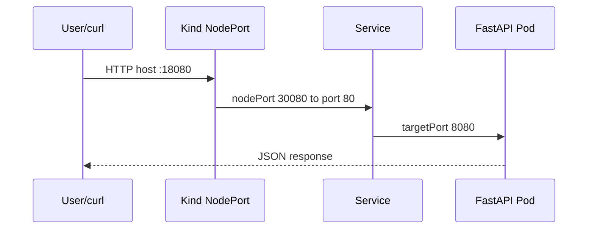

# شرح الـArchitecture بالمصري

## الصورة الكبيرة

راجع [architecture.svg](architecture/architecture.svg) ومصدرها [architecture.mmd](architecture/architecture.mmd). التصميم بيفصل عمدًا بين **AWS Terraform blueprint** و**local Kind runtime**. الرابط بينهم تعليمي/داخل نفس repository، مش network connection.

## Source وCI/CD

Developer يعمل commit وPull Request على GitHub. Workflow يشغل validations read-only. Python source يتحول في Docker build لـimage؛ Trivy يفحص packages. Terraform وCheckov يفحصوا AWS blueprint. Helm بيرندر Kubernetes YAML، وAnsible syntax بيتفحص. المراجعة البشرية شرط قبل merge. على main فقط يتم push لـGHCR باسم immutable Git SHA، ومفيش automatic deployment.

## Application وrequest flow

Local request يدخل من `127.0.0.1:18080` للـKind control-plane mapping ثم NodePort `30080`. Service يختار Pods عن طريق نفس labels الموجودة في Deployment. Uvicorn يسمع على `8080` داخل container ويرجع FastAPI response. ConfigMap يحقن environment/version/log level. الـoptional Ingress مسار بديل ويتطلب nginx controller غير مثبت افتراضيًا.

## Kubernetes resources

- Namespace يعزل المشروع ويطبق Pod Security restricted labels.
- Deployment يدير replica count وRollingUpdate.
- Pods containers non-root وبدون capabilities أو writable root filesystem.
- Startup probe يمنع liveness من قتل app أثناء البداية؛ readiness تمنع traffic قبل الجاهزية؛ liveness تعيد container لو process باظ.
- ClusterIP/NodePort Service يوفر stable virtual endpoint بدل Pod IP المتغير.
- ServiceAccount موجود كidentity لكن token automount مقفول لأن التطبيق لا يستدعي Kubernetes API.
- ConfigMap للبيانات غير السرية. لا يوجد Secret بقيمة حقيقية في Git.

## Helm lifecycle

Chart يحول values إلى resources. `helm upgrade --install` يعمل install أول مرة وupgrade بعد كده؛ history يحتفظ بالrevisions؛ rollback يرجع manifest/config سابق. `image.tag`, replicas, probes, resources وIngress configurable من values أو `--set`.

## AWS blueprint

VPC `10.30.0.0/16` موزع على 2 AZ. Public subnets مرتبطة public route table فيه `0.0.0.0/0 -> IGW`. Private subnets لها route tables بلا default Internet route؛ لا NAT. Security Group يسمح port 8080 من داخل VPC فقط ومفيهوش egress rule افتراضي. Default NACLs مستخدمة لتجنب stateless rules معقدة في demo.

Terraform provider يحتاج authentication حتى لبعض `plan` operations لأنه يقرأ Availability Zones. CI يعمل `init -backend=false` و`validate` فقط، ولا يثبت إن AWS deployment ممكن أو تم.

## Linux وAnsible

Ansible يشغل من WSL2 أو controller Linux إلى disposable Ubuntu VM عبر SSH. الـVM مسار اختياري منفصل. Role يثبت Docker وofficial tool binaries، ينشئ operator user ويعمل health checks. مش بيعدل Windows أو Docker Desktop مباشرة.

## Security boundaries والتنازلات

Repository لا يثق في PR بإذن كتابة. Container non-root وتقليل capabilities يقلل blast radius لكن لا يحول Kind إلى production. Pinning يقلل تغير builds، لكنه يحتاج تحديث دوري. GHCR token قصير العمر أفضل من PAT. Local NodePort مقبول للlab؛ production يحتاج TLS, ingress/load balancer, network policies, secrets manager وmulti-node control plane.

## Troubleshooting workflow

ابدأ بـ`kubectl get` للصورة العامة، ثم `describe` للevents/config، ثم `logs` لstdout، ثم endpoints/probes/resources. قارن desired state في Helm مع actual state. لو rollout فشل استخدم `helm history` و`helm rollback`. العشر labs بتطبق نفس التسلسل بدون لمس namespace الأساسي.

## حدود حقيقية

لا EKS، لا AWS runtime، لا database، لا advanced monitoring، لا autoscaling مفعل، ولا ingress controller افتراضي. `kubectl top` لن يعمل إلا بعد metrics-server. دي اختيارات مقصودة عشان المشروع يبقى مجاني، قابل لإعادة البناء، وقابل للشرح في interview.
