# Architecture Overview



The diagram has two honest environment boundaries:

- Orange: a Terraform-defined AWS VPC blueprint that CI validates but never deploys.
- Blue: the real local Kind runtime deployed manually through Helm.

Purple represents GitHub Actions and GHCR, green the optional Ansible-managed Ubuntu lab VM, and gray the cross-cutting security controls. There is deliberately no runtime network line between AWS and Kind.

Editable sources:

- `architecture.mmd` — complete system and environment boundaries.
- `ci-cd-pipeline.mmd` — pull request validation and main-only publication.
- `kubernetes-resources.mmd` — request routing and Kubernetes ownership.

Regenerate with Mermaid CLI 11.4.3:

```bash
mmdc -i architecture.mmd -o architecture.svg -b transparent
mmdc -i ci-cd-pipeline.mmd -o ci-cd-pipeline.svg -b transparent
mmdc -i kubernetes-resources.mmd -o kubernetes-resources.svg -b transparent
```
